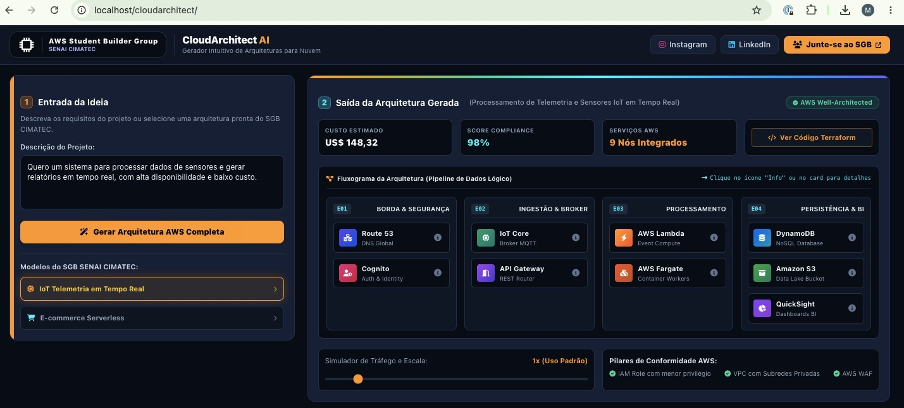
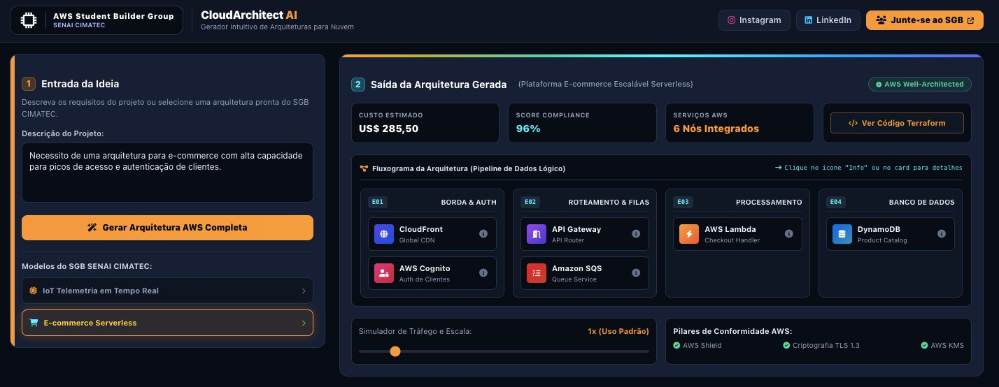

# ⚡ CloudArchitect AI

> **Gerador Intuitivo de Arquiteturas para Nuvem AWS**  
> Desenvolvido para o **DevFest**, em parceria com o **AWS Student Builder Group – SENAI CIMATEC**.

[](https://www.php.net/)
[](https://tailwindcss.com/)
[](https://aws.amazon.com/)
[](https://www.terraform.io/)

---

## 📌 Sobre o Projeto

O **CloudArchitect AI** é uma plataforma web criada para simplificar e acelerar o desenho de arquiteturas na nuvem AWS. A aplicação transforma requisitos de negócio em um pipeline visual estruturado por etapas, justificando cada ferramenta da *stack*, estimando custos e entregando o código **Terraform (IaC)** pronto para execução.

---

## ✨ Funcionalidades Principais

- 🚀 **Fluxograma em Pipeline (4 Etapas):** Visualização intuitiva organizada do tráfego (*Borda & Segurança* $\rightarrow$ *Ingestão & Mensageria* $\rightarrow$ *Processamento* $\rightarrow$ *Persistência & BI*).
- 💡 **Explicabilidade Técnica (Botão Info):** Exposição detalhada em cada serviço do motivo da escolha da ferramenta no ecossistema AWS.
- 🎯 **Conformidade Well-Architected:** Score percentual de boas práticas e checklist de pilares de segurança e compliance.
- 💰 **Simulador Dinâmico de Custos:** Controle deslizante de escala de tráfego que recalcula a estimativa mensal em Dólares (US$) em tempo real.
- 🛠️ **Infraestrutura como Código (IaC):** Geração automática de scripts Terraform (HCL) com botão de cópia em 1 clique.
- 📋 **Modelos de Referência Prontos:** Atalhos rápidos para arquiteturas de *IoT Telemetria em Tempo Real* e *E-commerce Serverless*.
- 🖥️ **Interface Responsiva & 0 Scroll:** Layout *widescreen* otimizado para apresentações sem poluição visual ou barras de rolagem desnecessárias.

---

## 📸 Demonstração da Interface

| Modelo IoT em Tempo Real | Modelo E-commerce Serverless |
| :---: | :---: |
|  |  |

---

## 🛠️ Tecnologias Utilizadas

* **Backend:** PHP 8+ (Lógica de roteamento, gestão de sessão e caching em JSON).
* **Frontend:** Tailwind CSS & Font Awesome (via CDN para leveza e alta velocidade).
* **Interatividade:** JavaScript Vanilla (manipulação de modais, simulador de escala e área de transferência).
* **IaC:** HashiCorp Terraform HCL (código de infraestrutura pré-configurado).

---

## 🚀 Como Executar Localmente

### Pré-requisitos
- **PHP 8.0** ou superior instalado na máquina.

### Opção 1: Servidor Embutido do PHP (Recomendado)

1. Clone ou baixe este repositório:
   ```bash
   git clone [https://github.com/mateuspauperio/cloudarchitect-ai.git](https://github.com/mateuspauperio/cloudarchitect-ai.git)
   cd cloudarchitect-ai

```

2. Inicie o servidor embutido do PHP:
```bash
php -S localhost:8000

```


3. Acesse no seu navegador: `http://localhost:8000`

---

### Opção 2: Servidor Apache (XAMPP / WAMP / LARAGON)

1. Copie a pasta do projeto para o diretório `htdocs` do seu ambiente servidor (ex: `C:/xampp/htdocs/cloudarchitect`).
2. Inicie o módulo Apache no painel do XAMPP.
3. Acesse no navegador: `http://localhost/cloudarchitect/`

> **Nota:** A pasta `cache/` para armazenamento local das arquiteturas customizadas é criada automaticamente pelo servidor no primeiro uso.

---

## ⚠️ Limitações do Protótipo

> Esta aplicação é um **protótipo funcional** desenvolvido para apresentações e demonstrações técnicas.

* Os modelos pré-definidos utilizam arquiteturas de referência estruturadas.
* Para descrições em texto livre, o protótipo gera uma arquitetura simulada com custos e pontuações calculados via algoritmo local, sem conexão direta com chamadas pagas da API de Preços da AWS ou LLMs em tempo real.

---

## 🗺️ Próximos Passos (Roadmap)

* [ ] Integração com modelo de IA generativa (LLM) para parser de texto em tempo real.
* [ ] Conexão direta com a *AWS Price List API* para cálculo de custos atualizado em tempo real.
* [ ] Exportação do diagrama da arquitetura em imagem (PNG/SVG) e PDF.
* [ ] Suporte à exportação para AWS CloudFormation e AWS CDK.

---

## 👥 Autores

Desenvolvido para o **DevFest**:

* **Mateus Pauperio** — [@mateuspauperio](https://github.com/mateuspauperio)
* **Kaique Rios** — [@kaiquerios](https://github.com/kaiquerios)

---
